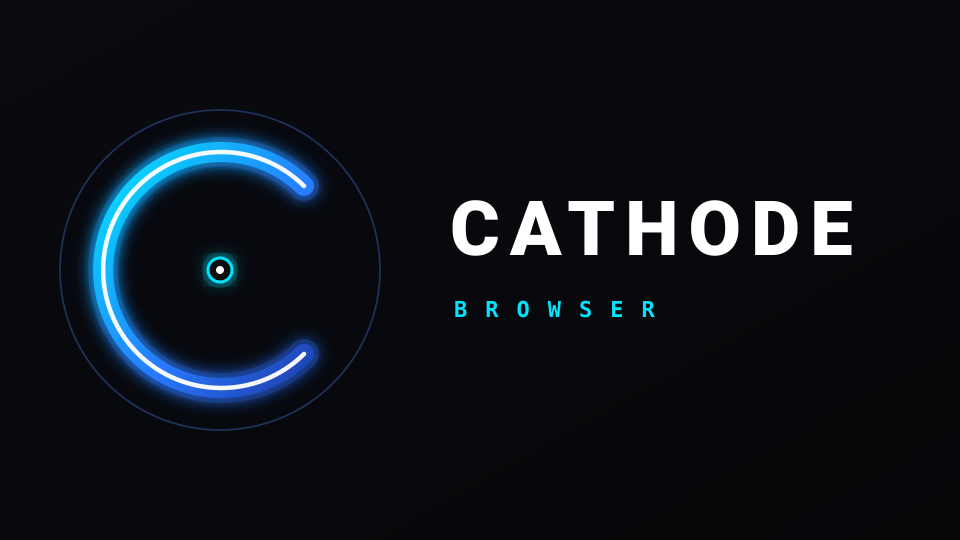

# Cathode Browser

An ultra-lean, bloat-free web browser built specifically for Android TV and Google TV with leanback remotes.

<p align="center">
  
</p>

## Highlights

- **Ultra-lightweight**: APK footprint is under 150 KB with zero external runtime dependencies.
- **Back-to-Navbar Architecture**: Pressing `BACK` while browsing brings up the navigation bar instead of abruptly quitting the app.
- **History Navigation**: Pressing `BACK` while on the navigation bar seamlessly navigates back in browser history (`webView.goBack()`).
- **One-Touch Bar Dismissal**: Pressing D-Pad `UP` or `DOWN` on the navigation bar exits directly back to web browsing.
- **Intelligent Modal & Popup Edge Scrolling**: When the cursor enters any floating popup, modal dialog, dropdown menu, or iframe (such as Google's 9-dot app drawer, cookie consent sheets, or nested containers), edge scrolling dynamically binds to the boundaries of that modal. Pushing against the top or bottom of the modal smoothly scrolls the container content without requiring the cursor to travel to the distant TV screen edges.
- **Two-Stage Scroll Detent & Unified Glass Reticles**: Reaching any scrollable edge keeps the standard circular reticle intact. The cursor only morphs into the directional scroll reticle (UP / DOWN) on the first extra push in that direction, featuring matching 3dp drop shadows and glass ring styling that ensures crisp readability over white, black, or colorful backgrounds.
- **Fluid 60fps Smooth Scrolling**: Chromium GPU-composited smooth scrolling (`behavior: 'smooth'`) for pages and containers, paired with targeted touch gestures for isolated cross-origin iframes.
- **Material Blue Page Progress & Clean Scrollbars**: Clean Electric Blue (`#2979FF`) loading bar paired with sleek 6px rounded Electric Blue scrollbars across both native Android views and injected Chromium DOM/WebKit elements (including wide pages, modals, iframes, and code blocks).
- **Two-Axis Edge Scrolling (Vertical & Horizontal)**: Pushing the virtual cursor against screen or modal boundaries scrolls in all 4 directions (UP, DOWN, LEFT, RIGHT), ensuring wide desktop layouts, data tables, and horizontal galleries are never cut off.
- **Bookmark Management & Clear Buttons**: Long-press OK on any bookmark chip (or press Menu/Window) to edit title, URL, or delete. Embedded `[ X ]` clear buttons in Name and URL inputs allow instant clearing via TV remote. Focused directly upon opening drawer.

---

## Remote Control Guide

| Remote Key | Context: Web Browsing | Context: Navigation Bar / Bookmarks |
| :--- | :--- | :--- |
| **D-Pad Directional Keys** | Moves virtual cursor across page | Tabs focus between navigation buttons and bookmarks |
| **D-Pad Center (OK)** | Simulates left-click at cursor position | Activates focused button / opens URL / opens bookmark |
| **D-Pad Center (Long-Press)** | None | On bookmark chip: opens Edit Bookmark dialog |
| **D-Pad Up / Down** | Edge scroll (when cursor is at screen edge) | Exits navigation bar back to web content |
| **BACK** | Opens bottom navigation bar | Navigates back in browser history / closes dialog |
| **Ch+ / Ch- / PgUp / PgDn** | Scrolls page up / down | Scrolls page up / down |
| **Red Button** | Toggles Bookmarks Drawer | Toggles Bookmarks Drawer |
| **Yellow Button** | Opens Add Bookmark dialog for current page | Opens Add Bookmark dialog for current page |
| **Green Button** | Reloads current page | Reloads current page |
| **Blue Button** | Focuses search bar at top | Focuses search bar at top |
| **Exit Button (on bar)** | - | Opens confirmation modal to exit |

---

## Memory & System Hygiene

- **Automatic Keyboard Dismissal**: Soft keyboard automatically dismisses when returning to webview, pausing, or closing dialogs.
- **System Memory Trimming**: Responds to `onTrimMemory(TRIM_MEMORY_MODERATE)` to release WebView caches when the TV is under memory pressure.
- **Clean Destruction**: Stops all ongoing network requests, clears history, loads `about:blank`, unregisters handler callbacks, and destroys the WebView when exiting.

---

## Building from Source

### Prerequisites
- JDK 17+ (or Amazon Corretto 21)
- Android SDK Platform `android-30`
- Android Build-Tools `35.0.0`

### Build Script
```bash
chmod +x build.sh
./build.sh
```
The compiled, aligned, and signed APK will be output to `build/Cathode.apk`.

---

## Testing & Installation

### Installing on Android TV (Physical Device)
1. Enable **Developer Options** and **ADB Debugging** on your Android TV.
2. Connect over local Wi-Fi:
   ```bash
   adb connect <tv-ip-address>:5555
   ```
3. Install the APK:
   ```bash
   adb install -r build/Cathode.apk
   ```

### Testing on Android TV Emulator
You can test Cathode on any Android TV or Google TV Virtual Device (AVD):
1. Open **Android Studio** -> **Device Manager** -> **Create Device**.
2. Select **TV** category (e.g. *Android TV (1080p)* or *Google TV (1080p)*).
3. Select system image with API 30+ (e.g., Android 11+ x86_64).
4. Launch the emulator.
5. In your terminal, run:
   ```bash
   adb install -r build/Cathode.apk
   adb shell am start -n com.cathode.browser/.MainActivity
   ```
6. Use keyboard arrow keys for D-Pad, Enter for OK, and Escape/Backspace for TV Remote `BACK`.

---

## License
MIT License
