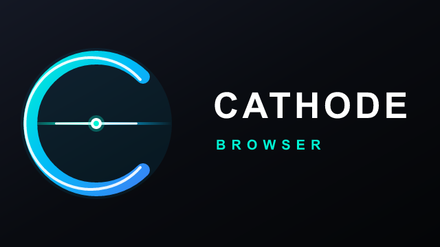

# Cathode Browser

An ultra-lean, bloat-free web browser built specifically for Android TV and Google TV with leanback remotes.

<p align="center">
  
</p>

## Highlights

- **Ultra-lightweight**: APK footprint is under 150 KB with zero external runtime dependencies.
- **Back-to-Navbar Architecture**: Pressing `BACK` while browsing brings up the navigation bar instead of abruptly quitting the app.
- **History Navigation**: Pressing `BACK` while on the navigation bar seamlessly navigates back in browser history (`webView.goBack()`).
- **One-Touch Bar Dismissal**: Pressing D-Pad `UP` or `DOWN` on the navigation bar exits directly back to web browsing.
- **Dynamic Edge Scroll with Detent**: Moving the virtual cursor across the screen never interferes with the UI. When the cursor lands at the screen perimeter, it morphs into an upward (`▲`) or downward (`▼`) scroll reticle without prematurely shifting content. An additional click (or holding the D-Pad) initiates smooth, gentle page scrolling in controlled 75px increments.
- **Two-Layer Universal Scrolling**:
  - **Layer 1 (Native)**: Hardware mouse-wheel `ACTION_SCROLL` events (`AXIS_VSCROLL`).
  - **Layer 2 (Universal DOM)**: Deep container scrolling that handles `window`, `document.scrollingElement`, `document.body`, and nested scrollable modals (e.g. cookie / GDPR consent overlays).
- **Dedicated App Exit Flow**: A clear Exit button `[->]` on the far left of the bottom bar with an Android TV confirmation dialog (`[Cancel]` / `[Exit]`) to prevent accidental quits.
- **Direct D-Pad Tabbing**: Full focusable support for TV remotes with high-contrast outlines (2.5dp pure white border on the URL input when focused).
- **Instant Search with Clear Button**: One-click `[ ✕ ]` button embedded directly in the search bar to clear input or start a new search.
- **Color Remote Shortcuts**:
  - 🔴 **Red**: Toggle Bookmarks Drawer
  - 🟢 **Green**: Reload Page
  - 🔵 **Blue**: Quick Search Mode
  - 📋 **Menu / Window**: Toggle Navigation Bar

---

## Remote Control Guide

| Remote Key | Context: Web Browsing | Context: Navigation Bar |
| :--- | :--- | :--- |
| **D-Pad Directional Keys** | Moves virtual cursor across page | Tabs focus between navigation buttons |
| **D-Pad Center (OK)** | Simulates left-click at cursor position | Activates focused button / opens URL |
| **D-Pad Up / Down** | Edge scroll (when cursor is at screen edge) | Exits navigation bar back to web content |
| **BACK** | Opens bottom navigation bar | Navigates back in browser history |
| **Ch+ / Ch- / PgUp / PgDn** | Scrolls page up / down | Scrolls page up / down |
| **Red Button** | Toggles Bookmarks Drawer | Toggles Bookmarks Drawer |
| **Green Button** | Reloads current page | Reloads current page |
| **Blue Button** | Focuses search bar at top | Focuses search bar at top |
| **Exit Button (on bar)** | — | Opens confirmation modal to exit |

---

## Memory & System Hygiene

- **Automatic Keyboard Dismissal**: Soft keyboard automatically dismisses when returning to webview, pausing, or closing dialogs.
- **System Memory Trimming**: Responds to `onTrimMemory(TRIM_MEMORY_MODERATE)` to release WebView caches when the TV is under memory pressure.
- **Clean Destruction**: Stops all ongoing network requests, clears history, loads `about:blank`, unregisters handler callbacks, and destroys the WebView when exiting.

---

## Building from Source

### Prerequisites
- JDK 17+ (or Amazon Corretto 21)
- Android SDK Platform `android-30`
- Android Build-Tools `35.0.0`

### Build Script
```bash
chmod +x build.sh
./build.sh
```
The compiled, aligned, and signed APK will be output to `build/Cathode.apk`.

---

## Testing & Installation

### Installing on Android TV (Physical Device)
1. Enable **Developer Options** and **ADB Debugging** on your Android TV.
2. Connect over local Wi-Fi:
   ```bash
   adb connect <tv-ip-address>:5555
   ```
3. Install the APK:
   ```bash
   adb install -r build/Cathode.apk
   ```

### Testing on Android TV Emulator
You can test Cathode on any Android TV or Google TV Virtual Device (AVD):
1. Open **Android Studio** -> **Device Manager** -> **Create Device**.
2. Select **TV** category (e.g. *Android TV (1080p)* or *Google TV (1080p)*).
3. Select system image with API 30+ (e.g., Android 11+ x86_64).
4. Launch the emulator.
5. In your terminal, run:
   ```bash
   adb install -r build/Cathode.apk
   adb shell am start -n com.cathode.browser/.MainActivity
   ```
6. Use keyboard arrow keys for D-Pad, Enter for OK, and Escape/Backspace for TV Remote `BACK`.

---

## License
MIT License
